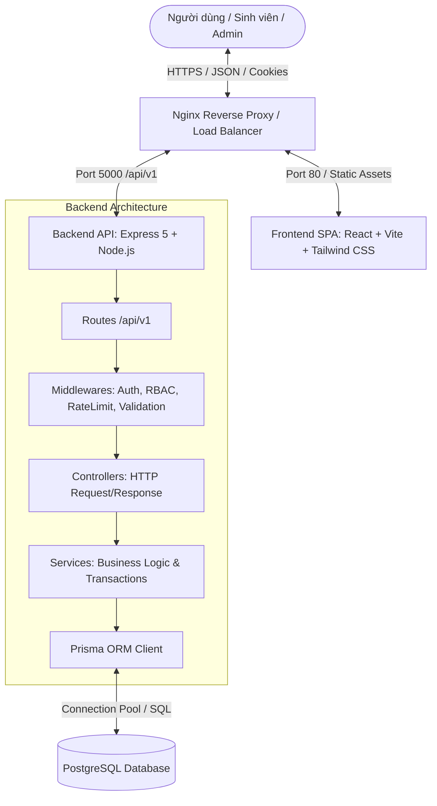

# UNIVERSITY CLUB PORTAL — KIẾN TRÚC HỆ THỐNG (SYSTEM ARCHITECTURE)

## 1. Mô hình tổng thể (High-Level Architecture)

Hệ thống được thiết kế theo mô hình Monorepo 3 tầng (3-Tier Decoupled Architecture):
- **Client Tier (Frontend):** Ứng dụng SPA (Single Page Application) sử dụng React, Vite, Tailwind CSS, TanStack Query, React Router.
- **Application Tier (Backend API):** RESTful Web Service sử dụng Node.js (ES Modules) và Express.js 5, tổ chức theo mô hình Layered Architecture (Controller - Service - Repository/Prisma).
- **Data Tier (Database):** Hệ quản trị cơ sở dữ liệu quan hệ PostgreSQL, quản lý lược đồ và di trú thông qua Prisma ORM.



---

## 2. Cấu trúc thư mục Monorepo

```
Web_GT-CLB/
├── .github/
│   └── workflows/
│       └── ci.yml               # GitHub Actions CI lint, test, build
├── docs/                        # Tài liệu kiến trúc, database, api contract
│   ├── REQUIREMENTS.md
│   ├── ARCHITECTURE.md
│   ├── DATABASE_DESIGN.md
│   ├── API_CONTRACT.md
│   └── IMPLEMENTATION_PLAN.md
├── docker/
│   ├── nginx/
│   │   └── default.conf         # Cấu hình reverse proxy
│   ├── Dockerfile.frontend
│   └── Dockerfile.backend
├── docker-compose.yml           # Compose chạy toàn bộ Postgres, Backend, Frontend, Nginx
├── .env.example
├── .gitignore
├── README.md
├── backend/                     # Node.js + Express 5 + Prisma API
│   ├── prisma/
│   │   ├── schema.prisma        # Lược đồ cơ sở dữ liệu quan hệ
│   │   ├── migrations/          # Lịch sử migration
│   │   └── seed.js              # Dữ liệu mẫu (10+ CLB, Admin, Student, Campaign...)
│   ├── src/
│   │   ├── config/              # Biến môi trường, database client
│   │   ├── constants/           # Enums, roles, status
│   │   ├── middlewares/         # auth.js, rbac.js, validate.js, errorHandler.js
│   │   ├── modules/
│   │   │   ├── auth/            # Auth Controller, Service, Route
│   │   │   ├── users/           # User & Student Profile
│   │   │   ├── clubs/           # Clubs, Categories, Members
│   │   │   ├── recruitments/    # Campaigns, ApplicationForms, Questions
│   │   │   ├── applications/    # Submit, Review, Membership transaction
│   │   │   ├── events/          # Events & Registrations
│   │   │   ├── posts/           # Club News & Posts
│   │   │   └── admin/           # Super Admin Dashboard & Audit Logs
│   │   ├── utils/               # JWT helper, hash helper, logger, responseFormatter
│   │   ├── app.js               # Express application config
│   │   └── server.js            # Server entrypoint
│   ├── tests/                   # Vitest & Supertest API tests
│   └── package.json
└── frontend/                    # React 19/18 + Vite + Tailwind CSS
    ├── public/                  # Static assets & icons
    ├── src/
    │   ├── assets/              # Hình ảnh, logos
    │   ├── components/          # Reusable UI components (Button, Modal, Card, Table...)
    │   ├── layouts/             # MainLayout, DashboardLayout, AdminLayout
    │   ├── pages/               # Trang công khai & các dashboard
    │   │   ├── public/          # Home, Clubs, ClubDetail, Login, Register, Events
    │   │   ├── student/         # Student Dashboard, My Applications, Profile
    │   │   ├── club-admin/      # Club Admin Dashboard, Recruitment, Members, Events
    │   │   └── super-admin/     # Super Admin Dashboard, Clubs Management, Users
    │   ├── context/             # AuthContext, NotificationContext
    │   ├── services/            # Axios/Fetch API client kết nối Backend
    │   ├── hooks/               # Custom hooks (useAuth, useDebounce...)
    │   ├── routes/              # React Router v6/v7 config & ProtectedRoute
    │   ├── styles/              # index.css với Tailwind CSS tokens
    │   ├── App.jsx
    │   └── main.jsx
    ├── index.html
    ├── vite.config.js
    └── package.json
```

---

## 3. Cơ chế Bảo mật và Xác thực (Security & Authentication)

1. **Cookie-based Authentication & JWT:**
   - Sử dụng Access Token ngắn hạn và Refresh Token lưu trữ trong Cookie an toàn (`httpOnly: true`, `secure: process.env.NODE_ENV === 'production'`, `sameSite: 'lax'`).
   - Ngăn chặn triệt để tấn công XSS lấy cắp token từ LocalStorage.
2. **Kiểm soát phân quyền 2 lớp (Resource-Based Authorization):**
   - Lớp 1: Kiểm tra vai trò toàn hệ thống (`role` trong User: `STUDENT`, `SUPER_ADMIN`).
   - Lớp 2: Kiểm tra vai trò theo từng tài nguyên CLB cụ thể thông qua bảng `ClubMembership` với quyền `CLUB_ADMIN` hoặc `CLUB_MEMBER`.
   - Ngăn chặn tấn công IDOR (Insecure Direct Object Reference) và Privilege Escalation: Club Admin CLB A tuyệt đối không thể can thiệp dữ liệu CLB B.
3. **Transaction an toàn cho duyệt đơn:**
   - Thao tác duyệt đơn (`ACCEPTED`) sử dụng `prisma.$transaction`:
     1. Khóa và kiểm tra trạng thái đơn hiện tại.
     2. Cập nhật trạng thái `Application` thành `ACCEPTED`.
     3. Tạo mới `ClubMembership` cho sinh viên trong CLB (với role `MEMBER`).
     4. Ghi `AuditLog` lưu vết ai đã duyệt vào lúc nào.
     5. Tạo bản ghi `Notification` cho sinh viên.
4. **Bảo vệ API:**
   - Sử dụng `helmet` thiết lập các HTTP security headers.
   - Sử dụng `express-rate-limit` chống Brute-force trên các endpoint nhạy cảm (`/auth/login`, `/auth/register`).
   - Validation chặt chẽ toàn bộ Body, Query và Params bằng thư viện Zod.
