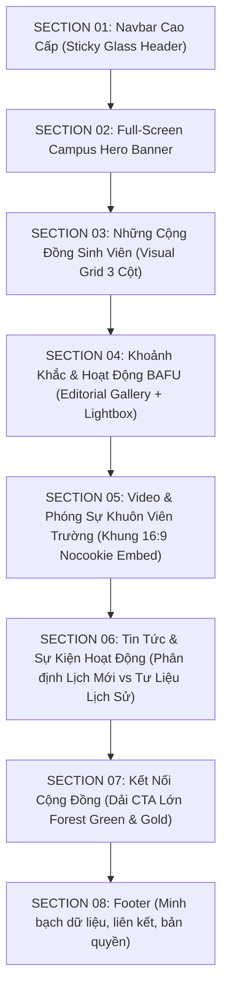

# Báo Cáo Kiến Trúc & Thiết Kế Lại Toàn Diện Trang Chủ BAFU
*(BAFU Homepage Redesign Architecture & Design System Report)*

- **Dự án:** Cổng thông tin Câu lạc bộ Sinh viên BAFU (*Web_GT-CLB*)
- **Phong cách:** Modern University Campus × Premium Editorial × Youth Community Experience
- **Thời điểm hoàn thành:** 01/11/2026
- **Chuyên trách:** UI/UX Design Director & Senior Frontend Engineer

---

## 1. Định Hướng & Hệ Thống Nhận Diện (Design System)

### 1.1. Bảng Màu Chủ Đạo (Color Palette)

| Tên màu | Mã Hex | Vai trò trong hệ thống UI |
|:---|:---:|:---|
| **Forest Green** | `#0F5132` | Màu thương hiệu đại học truyền thống, biểu trưng cho nông - lâm nghiệp và thiên nhiên |
| **Emerald** | `#16845A` | Màu nhấn thanh xuân, nút CTA chính, huy hiệu trạng thái xác minh |
| **Cream White** | `#F8FAF7` | Màu nền giao diện chính, êm dịu thị giác, tạo chiều sâu biên tập cao cấp |
| **Charcoal** | `#17211C` | Màu chữ chính, nền footer và overlay hero banner đảm bảo độ tương phản chuẩn WCAG AAA |
| **Accent Gold** | `#E7B85B` | Màu điểm nhấn thanh xuân, nhãn mục tiêu, chỉ số đếm và dấu ấn thương hiệu |
| **Border Neutral**| `#D8D5CD` | Đường viền thanh mảnh, phân tách tinh tế giữa các thẻ nội dung |

### 1.2. Kiểu Chữ (Typography)
- **Font Display & Body:** `Be Vietnam Pro` (hỗ trợ tiếng Việt hoàn hảo, nét chữ hiện đại, rõ ràng, hình học).
- **Phân cấp kiểu chữ:**
  - `Hero Display`: 4xl (mobile: 36px) đến 7xl (desktop: 72px), `font-black`, leading tight.
  - `Section Heading`: 2xl đến 4xl, `font-black`, có nhãn "MỤC 01, 02...".
  - `Card Titles`: lg đến xl, `font-bold`.
  - `Body & Metadata`: sm đến base (14px - 16px), line-height thư thái (1.6 - 1.7).

---

## 2. Cấu Trúc 8 Section Chi Tiết

### Chi tiết từng Section:

1. **SECTION 01 — Navbar cao cấp:**
   - Header cố định (`sticky top-0 z-40 bg-white/95 backdrop-blur-md`).
   - Wordmark typographic: "BF BAFU. CAMPUS CLUBS - Cổng thông tin sinh viên" (responsive co giãn không tràn viền).
   - Menu điều hướng: *Trang chủ*, *Câu lạc bộ*, *Hoạt động*, *Sự kiện*.
   - Nút đăng nhập/đăng ký hoặc thông tin tài khoản nếu đã đăng nhập.
   - Drawer mobile linh hoạt với nút Hamburger phản hồi mượt mà.

2. **SECTION 02 — Full-Screen Hero Banner (Ưu tiên cao nhất):**
   - Tràn 100% chiều ngang viewport (vượt ra ngoài `.editorial-container`).
   - Chiều cao desktop: 760px; mobile: tối thiểu 680px.
   - Nền ảnh khuôn viên BAFU toàn cảnh độ phân giải cao (`/images/bafu/campus-overview.jpg`) từ nguồn trường.
   - Lớp phủ tối đa điểm dừng (multi-stop deep dark overlay) bảo đảm chữ trắng và vàng nổi bật sắc nét.
   - Tiêu đề: **KHÁM PHÁ CỘNG ĐỒNG SINH VIÊN BAFU**.
   - Dual CTA: "Khám phá câu lạc bộ ↗" (màu Emerald) & "Tìm hiểu hoạt động" (kính mờ).
   - Thanh tìm kiếm câu lạc bộ dạng floating bar với các chip gợi ý nhanh theo lĩnh vực.
   - Thanh đếm chỉ số thời gian thực và dòng ghi chú nguồn ảnh minh bạch (`bafu.edu.vn`).

3. **SECTION 03 — Khám phá những cộng đồng sinh viên:**
   - Layout dạng visual grid 3 cột trên desktop.
   - Hiển thị đầy đủ 5 câu lạc bộ đã xác minh tài liệu.
   - Mỗi card có ảnh bìa fallback trung tính có nhãn "Hình ảnh đang cập nhật", huy hiệu phân loại, ô logo "Chờ logo", tên CLB, mô tả ngắn, trạng thái thông tin và nút liên kết chi tiết.

4. **SECTION 04 — Hoạt động sinh viên BAFU (Editorial Gallery):**
   - Thiết kế bất đối xứng (Asymmetric layout): 1 ảnh lớn bên trái (Gala chào tân sinh viên) chiếm 7 cột; 3 ảnh nhỏ xếp cột bên phải (BAFU Cup, phòng thí nghiệm, lễ tốt nghiệp) chiếm 5 cột.
   - Mỗi ảnh đều có nhãn phạm vi tư liệu, chú thích nội dung và nguồn gốc `bafu.edu.vn`.
   - Tính năng tương tác: Click vào ảnh mở **Lightbox Modal** xem ảnh lớn độ phân giải cao kèm thông tin chi tiết và link bài gốc.

5. **SECTION 05 — Video và khoảnh khắc sinh viên:**
   - Trình phát video tỉ lệ 16:9 responsive chuẩn mực.
   - Tích hợp video phóng sự thực tế khuôn viên BAFU từ kênh chính thức `@dhnlbg` (`pewDI97HQDQ`) với giao thức nhúng bảo mật `youtube-nocookie.com`.
   - Cột thông tin đồng hành giới thiệu không gian sinh thái hồ nước, đồi cây, hội trường A1 và sân thể thao của trường.

6. **SECTION 06 — Tin tức và sự kiện hoạt động:**
   - Thanh chuyển tab phân định rõ ràng:
     - Tab 1: *Tư liệu hoạt động đã diễn ra (2)*: Sự kiện Trung thu 2024 (CLB Tình nguyện Xanh) và Lễ ra mắt CLB Khởi nghiệp 2018 (CLB Khởi nghiệp) với ngày tháng gốc và link bài báo.
     - Tab 2: *Lịch sự kiện sắp tới (0)*: Trạng thái rỗng chân thực, thông báo lịch mới sẽ xuất hiện khi có thông báo chính thức.

7. **SECTION 07 — Kết nối cộng đồng:**
   - Dải banner toàn khổ màu xanh Forest Green `#0F5132` phối vàng `#E7B85B`.
   - Lời kêu gọi truyền cảm hứng thanh xuân cho sinh viên tham gia phong trào.
   - Các nút CTA liên kết đến thư mục CLB và tra cứu sự kiện.

8. **SECTION 08 — Footer:**
   - Khối nhận diện typographic trên nền tối than củi `#17211C`.
   - Hệ thống liên kết nội bộ và liên kết ngoài tới website nhà trường `bafu.edu.vn`.
   - Tuyên bố minh bạch: Cổng thông tin thí điểm, toàn bộ dữ liệu đối chiếu từ tài liệu lưu trữ chính thức.

---

## 3. Danh Sách Các Tệp Đã Can Thiệp & Cải Tiến

1. `frontend/src/pages/public/HomePage.jsx`: Thiết kế lại hoàn toàn cấu trúc trang chủ gồm 8 section mới, tích hợp gallery bất đối xứng, video nhúng và lightbox.
2. `frontend/src/components/editorial/CampusMasthead.jsx`: Thiết kế lại toàn bộ hero banner thành full-width banner với nền khuôn viên BAFU, floating search bar và metrics bar.
3. `frontend/src/components/editorial/FeatureClubTile.jsx`: Cải tiến thẻ CLB nổi bật với fallback trung tính và hiển thị trạng thái xác minh rõ ràng.
4. `frontend/src/components/editorial/EditorialClubCard.jsx`: Cải tiến thẻ CLB nhỏ gọn, chuẩn quy tắc React hook, hiển thị nhãn hoạt động và nguồn bài viết.
5. `frontend/src/components/editorial/ClubVisual.jsx`: Loại bỏ ảnh galaxy, thay bằng gradient nhận diện danh mục và nhãn "Hình ảnh đang cập nhật".
6. `frontend/src/components/ui/BrandWordmark.jsx`: Chuẩn hóa logo chữ BAFU CAMPUS CLUBS, responsive ẩn phụ đề trên mobile để tránh tràn thanh navbar.
7. `frontend/src/components/ui/ClubLogo.jsx`: Xóa bỏ bản đồ logo không rõ nguồn gốc, dùng fallback chuẩn "Chờ logo".
8. `frontend/src/components/Navbar.jsx`: Thêm mục "Hoạt động", tinh chỉnh màu sắc xanh Forest Green và hỗ trợ menu mobile.
9. `frontend/src/components/Footer.jsx`: Viết lại footer cao cấp, phân chia cột rõ ràng và bổ sung phần minh bạch dữ liệu.
10. `frontend/src/utils/bafuData.js`: Loại bỏ dữ liệu seed giả lập, chỉ giữ 5 CLB có nguồn và 2 sự kiện lịch sử đã kiểm chứng.
11. `frontend/src/utils/clubIdentity.js`: Loại bỏ toàn bộ tham chiếu tới ảnh galaxy, chuẩn hóa màu sắc và gradient danh mục.
12. `frontend/src/pages/public/ClubDetailPage.jsx`: Loại bỏ ảnh galaxy khỏi banner trang chi tiết câu lạc bộ.
13. `frontend/src/layouts/MainLayout.jsx`: Cập nhật màu nền tổng thể thành `#F8FAF7`.
14. `frontend/index.html`: Chỉnh sửa thẻ title, meta description và favicon SVG nhận diện thương hiệu.
15. `frontend/public/images/asset-manifest.json`: Bổ sung toàn diện danh mục phân loại tư liệu truyền thông và trạng thái cấp quyền.
16. `e2e/capture_redesign_screenshots.mjs`: Script tự động chụp ảnh kiểm thử trên 4 độ phân giải và các trạng thái tương tác.

