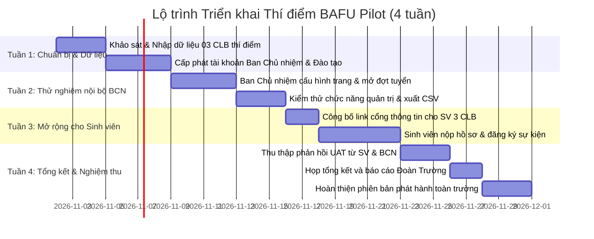

# KẾ HOẠCH TRIỂN KHAI THÍ ĐIỂM TẠI BAFU (BAFU PILOT PLAN)
## Dự án: University Club Portal — BAFU
**Địa bàn áp dụng:** Trường Đại học Nông Lâm Bắc Giang (BAFU)  
**Phiên bản kế hoạch:** 1.0  
**Giai đoạn:** Phase 6 — Release Hardening, UAT & BAFU Pilot  
**Chủ trì:** Đội ngũ phát triển phối hợp cùng Đoàn Thanh niên — Hội Sinh viên Trường Đại học Nông Lâm Bắc Giang  

---

## 1. MỤC ĐÍCH VÀ NGUYÊN TẮC THÍ ĐIỂM (GOALS & PRINCIPLES)

### 1.1 Mục đích
1. Đưa hệ thống vào vận hành thực tế ở quy mô kiểm soát (Pilot Cohort) để đánh giá tính thích ứng với quy chế hoạt động của các Câu lạc bộ tại Trường Đại học Nông Lâm Bắc Giang.
2. Kiểm tra độ chịu tải và tính ổn định của hạ tầng máy chủ trong môi trường mạng nội bộ và mạng Internet giáo dục.
3. Chuẩn hóa quy trình số hóa công tác tuyển sinh viên vào CLB, quản lý hội viên và cấp chứng nhận tham gia hoạt động/sự kiện ngoại khóa.

### 1.2 Nguyên tắc bắt buộc
- **Phân định rõ ràng dữ liệu thử nghiệm và dữ liệu chính thức:** Dữ liệu mẫu (Demo) mang nhãn `[DEMO]` phải được dọn dẹp hoặc gắn cờ phân biệt rõ trước khi nhập danh sách CLB thật.
- **Không tự ý thu thập dữ liệu cá nhân nhạy cảm:** Mọi tài khoản sinh viên tham gia pilot phải có sự đồng ý (Consent) theo Điều khoản sử dụng và Chính sách bảo vệ dữ liệu cá nhân.
- **Quy trình phê duyệt chặt chẽ:** Chỉ các Câu lạc bộ có quyết định thành lập hoặc văn bản xác nhận của Đoàn trường / Hội Sinh viên BAFU mới được cấp trạng thái `ACTIVE` trên cổng thông tin.

---

## 2. PHẠM VI VÀ DANH SÁCH CÂU LẠC BỘ THAM GIA THÍ ĐIỂM (PILOT COHORT)

Giai đoạn thí điểm diễn ra trong **4 tuần** với sự tham gia của **03 Câu lạc bộ tiên phong** đại diện cho 3 khối hoạt động chủ lực của trường:

| STT | Tên Câu lạc bộ | Khối | Số lượng thành viên dự kiến | Nội dung trọng tâm thí điểm |
| :---: | :--- | :--- | :---: | :--- |
| 1 | **CLB Tình Nguyện Xanh BAFU** | Tình nguyện & Xã hội | 60 - 80 SV | Đăng ký sự kiện chiến dịch tình nguyện; quản lý danh sách hội viên thường trực |
| 2 | **CLB Tiếng Anh BAFU (BEC)** | Học thuật & Kỹ năng | 40 - 50 SV | Mở đợt tuyển thành viên mới bằng Form động có câu hỏi phỏng vấn tiếng Anh |
| 3 | **CLB Bóng Đá Sinh Viên BAFU** | Thể dục & Thể thao | 30 - 40 SV | Tổ chức giải đấu giao hữu; upload album ảnh hoạt động sau trận đấu |

---

## 3. LỘ TRÌNH TRIỂN KHAI CHI TIẾT (ROLLOUT TIMELINE - 4 TUẦN)

### Chi tiết các giai đoạn:

#### Tuần 1: Chuẩn bị hạ tầng & Dữ liệu khởi tạo (Pre-Pilot)
- Quản trị viên sử dụng mẫu file CSV (`/admin/clubs/template-csv`) để nhập danh mục 3 CLB tiên phong vào hệ thống.
- Cấp quyền `CLUB_ADMIN` cho 3 Chủ nhiệm CLB bằng tài khoản email trường (`@bafu.edu.vn` hoặc email đăng ký).
- Tổ chức 01 buổi tập huấn trực tuyến (45 phút) hướng dẫn BCN sử dụng dashboard quản trị.

#### Tuần 2: Thử nghiệm vận hành nội bộ Ban Chủ nhiệm (BCN Onboarding)
- BCN tải lên Logo nhận diện chuẩn và Ảnh bìa chất lượng cao.
- Thiết lập mô tả, tôn chỉ mục đích và thông tin liên hệ chính thức của CLB.
- Tạo đợt tuyển thành viên thử nghiệm với 3-5 câu hỏi tùy chỉnh.
- Tạo ít nhất 01 sự kiện sinh hoạt định kỳ.

#### Tuần 3: Mở rộng cho sinh viên tham gia (Student Engagement)
- Chia sẻ đường dẫn chính thức của 3 CLB trên các kênh thông tin truyền thông của Đoàn trường và Fanpage CLB.
- Tiếp nhận hồ sơ sinh viên đăng ký tham gia CLB trực tuyến.
- Ban Chủ nhiệm thực hiện quy trình duyệt hồ sơ, chấm điểm phỏng vấn và gửi thông báo kết quả qua hệ thống.

#### Tuần 4: Đánh giá, tổng kết và chuyển giao (Evaluation & Handover)
- Trích xuất toàn bộ dữ liệu ứng viên và hội viên ra định dạng CSV để đối chiếu.
- Khảo sát mức độ hài lòng của sinh viên (CSAT) và Ban Chủ nhiệm theo thang điểm 5.
- Lập Báo cáo kết quả thí điểm gửi Ban Giám hiệu và Đoàn Thanh niên BAFU phê duyệt kế hoạch triển khai diện rộng.

---

## 4. QUY TRÌNH HỖ TRỢ KỸ THUẬT VÀ PHẢN ỨNG SỰ CỐ (SLA & SUPPORT)

### 4.1 Đội ngũ thường trực kỹ thuật
- **Đại diện Kỹ thuật & DevOps:** Phụ trách vận hành container, sao lưu cơ sở dữ liệu hàng đêm lúc 01:00 AM.
- **Đại diện Nghiệp vụ (Product Support):** Tiếp nhận yêu cầu mở khóa tài khoản, cấp lại mật khẩu hoặc hỗ trợ tải lên tệp tin.

### 4.2 Ma trận xử lý sự cố (SLA)
- **Sự cố tê liệt máy chủ / không truy cập được:** Cam kết phục hồi trong vòng **30 phút**.
- **Sự cố lỗi gửi thông báo / không tải được ảnh:** Khắc phục trong vòng **4 giờ**.
- **Yêu cầu hỗ trợ thao tác người dùng:** Phản hồi trong vòng **2 giờ** trong giờ hành chính.

---

## 5. TIÊU CHÍ ĐÁNH GIÁ THÀNH CÔNG (SUCCESS CRITERIA FOR PILOT)

Hệ thống được coi là hoàn thành xuất sắc giai đoạn Pilot và đủ điều kiện triển khai toàn trường khi đạt các chỉ số sau:
1. **Tỷ lệ khả dụng hệ thống (Uptime):** Đạt tối thiểu **99.5%** trong suốt 4 tuần chạy thử.
2. **Số lượng hồ sơ tiếp nhận:** Đạt tối thiểu **100 lượt ứng tuyển** từ sinh viên qua form trực tuyến.
3. **Mức độ hài lòng chung:** Đạt điểm trung bình từ **4.2 / 5.0** trở lên theo khảo sát UAT.
4. **Không có sự cố rò rỉ dữ liệu:** Dữ liệu cá nhân, đánh giá nội bộ của ban chủ nhiệm được bảo vệ tuyệt đối an toàn.
5. **Toàn vẹn sao lưu:** 100% các bản sao lưu tự động hàng tuần được xác minh khả năng phục hồi thành công.
