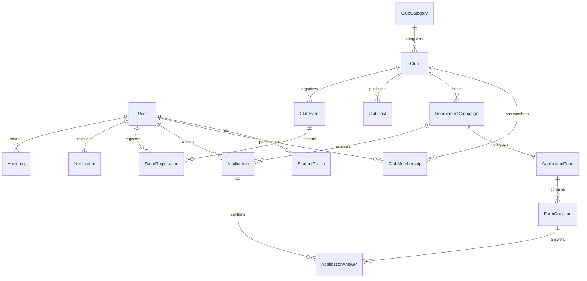

# UNIVERSITY CLUB PORTAL — THIẾT KẾ CƠ SỞ DỮ LIỆU (DATABASE DESIGN)

## 1. Mô hình ERD (Entity-Relationship Diagram)

---

## 2. Chi tiết các bảng thực thể (Entities Definition)

### 2.1. User & StudentProfile
- **User:**
  - `id`: UUID (Primary Key)
  - `email`: String (Unique, Indexed)
  - `passwordHash`: String
  - `role`: Enum `SystemRole` (`STUDENT`, `SUPER_ADMIN`) - Default `STUDENT`
  - `isActive`: Boolean - Default `true`
  - `createdAt`: DateTime
  - `updatedAt`: DateTime
- **StudentProfile:**
  - `id`: UUID (Primary Key)
  - `userId`: UUID (Unique, Foreign Key -> User.id, Cascade Delete)
  - `fullName`: String (Indexed)
  - `studentCode`: String (Unique, Indexed)
  - `faculty`: String (Khoa/Viện)
  - `major`: String (Ngành)
  - `academicYear`: String (Khóa, ví dụ K45, K46)
  - `phone`: String
  - `avatarUrl`: String (Nullable)
  - `bio`: Text (Nullable)
  - `skills`: String (Nullable, danh sách kỹ năng)
  - `interests`: String (Nullable, sở thích)
  - `createdAt`, `updatedAt`

### 2.2. ClubCategory & Club
- **ClubCategory:**
  - `id`: UUID (Primary Key)
  - `name`: String (Unique) - Thể thao, Học thuật, Văn nghệ, Tình nguyện, Kỹ năng...
  - `slug`: String (Unique)
  - `description`: Text (Nullable)
  - `icon`: String (Tên icon lucide)
  - `displayOrder`: Int - Default 0
- **Club:**
  - `id`: UUID (Primary Key)
  - `name`: String (Unique)
  - `slug`: String (Unique, Indexed)
  - `shortDescription`: String
  - `description`: Text
  - `categoryId`: UUID (Foreign Key -> ClubCategory.id)
  - `logoUrl`: String (Nullable)
  - `coverUrl`: String (Nullable)
  - `email`: String (Nullable)
  - `phone`: String (Nullable)
  - `fanpageUrl`: String (Nullable)
  - `establishedDate`: DateTime (Nullable)
  - `meetingSchedule`: String (Nullable)
  - `status`: Enum `ClubStatus` (`PENDING`, `ACTIVE`, `INACTIVE`) - Default `ACTIVE`
  - `createdAt`, `updatedAt`

### 2.3. ClubMembership (Phân quyền scoped theo CLB)
- **ClubMembership:**
  - `id`: UUID (Primary Key)
  - `userId`: UUID (Foreign Key -> User.id)
  - `clubId`: UUID (Foreign Key -> Club.id)
  - `role`: Enum `ClubRole` (`MEMBER`, `VICE_LEADER`, `LEADER`) - Default `MEMBER`
  - `joinedAt`: DateTime - Default now()
  - `status`: Enum `MembershipStatus` (`ACTIVE`, `INACTIVE`, `BANNED`) - Default `ACTIVE`
  - `createdAt`, `updatedAt`
  - **Constraint:** `@@unique([userId, clubId])` — Đảm bảo 1 sinh viên chỉ có duy nhất 1 bản ghi thành viên trong 1 CLB.

### 2.4. RecruitmentCampaign & Dynamic Form
- **RecruitmentCampaign:**
  - `id`: UUID (Primary Key)
  - `clubId`: UUID (Foreign Key -> Club.id)
  - `title`: String
  - `slug`: String (Indexed)
  - `description`: Text
  - `requirements`: Text (Nullable)
  - `targetQuantity`: Int (Chỉ tiêu dự kiến) - Default 0
  - `startDate`: DateTime
  - `endDate`: DateTime
  - `status`: Enum `CampaignStatus` (`DRAFT`, `OPEN`, `CLOSED`) - Default `DRAFT`
  - `createdAt`, `updatedAt`
- **ApplicationForm:**
  - `id`: UUID (Primary Key)
  - `campaignId`: UUID (Unique, Foreign Key -> RecruitmentCampaign.id, Cascade Delete)
  - `title`: String
  - `description`: Text (Nullable)
  - `createdAt`, `updatedAt`
- **FormQuestion:**
  - `id`: UUID (Primary Key)
  - `formId`: UUID (Foreign Key -> ApplicationForm.id, Cascade Delete)
  - `questionText`: String
  - `questionType`: Enum `QuestionType` (`SHORT_TEXT`, `LONG_TEXT`, `SINGLE_CHOICE`, `MULTIPLE_CHOICE`, `DATE`, `NUMBER`, `URL`)
  - `options`: JSON (Mảng các lựa chọn nếu là SINGLE/MULTIPLE_CHOICE)
  - `isRequired`: Boolean - Default true
  - `orderIndex`: Int - Default 0

### 2.5. Application & ApplicationAnswer
- **Application:**
  - `id`: UUID (Primary Key)
  - `campaignId`: UUID (Foreign Key -> RecruitmentCampaign.id)
  - `userId`: UUID (Foreign Key -> User.id)
  - `status`: Enum `ApplicationStatus` (`DRAFT`, `SUBMITTED`, `UNDER_REVIEW`, `NEED_MORE_INFO`, `ACCEPTED`, `REJECTED`, `WITHDRAWN`) - Default `SUBMITTED`
  - `internalNotes`: Text (Nullable) — Ghi chú bảo mật của BCN CLB, sinh viên không được xem
  - `submittedAt`: DateTime - Default now()
  - `reviewedAt`: DateTime (Nullable)
  - `reviewedByUserId`: UUID (Nullable, Foreign Key -> User.id)
  - `createdAt`, `updatedAt`
  - **Logic ràng buộc:** Ngăn nộp đơn trùng hoạt động: Khi nộp, kiểm tra nếu đã có đơn thuộc `campaignId` + `userId` có trạng thái khác `WITHDRAWN` hoặc `REJECTED` thì từ chối.
- **ApplicationAnswer:**
  - `id`: UUID (Primary Key)
  - `applicationId`: UUID (Foreign Key -> Application.id, Cascade Delete)
  - `questionId`: UUID (Foreign Key -> FormQuestion.id, Cascade Delete)
  - `questionTextSnapshot`: String — Lưu giữ câu hỏi tại thời điểm ứng tuyển
  - `answerValue`: Text / JSON — Lưu câu trả lời của ứng viên

### 2.6. ClubPost, ClubEvent, EventRegistration
- **ClubPost:**
  - `id`: UUID, `clubId`: UUID, `authorId`: UUID, `title`: String, `slug`: String, `content`: Text, `thumbnail`: String, `isPinned`: Boolean, `createdAt`, `updatedAt`
- **ClubEvent:**
  - `id`: UUID, `clubId`: UUID, `title`: String, `slug`: String, `description`: Text, `location`: String, `startTime`: DateTime, `endTime`: DateTime, `maxParticipants`: Int, `isPublic`: Boolean, `status`: Enum `EventStatus` (`UPCOMING`, `ONGOING`, `COMPLETED`, `CANCELLED`), `createdAt`, `updatedAt`
- **EventRegistration:**
  - `id`: UUID, `eventId`: UUID, `userId`: UUID, `registeredAt`: DateTime, `status`: Enum `RegistrationStatus` (`REGISTERED`, `ATTENDED`, `CANCELLED`)
  - `@@unique([eventId, userId])`

### 2.7. Notification & AuditLog
- **Notification:** `id`, `userId`, `title`, `content`, `type`, `link`, `isRead` (Boolean), `createdAt`
- **AuditLog:** `id`, `userId` (Nullable), `action`, `entityType`, `entityId`, `details` (JSON), `ipAddress`, `createdAt`
